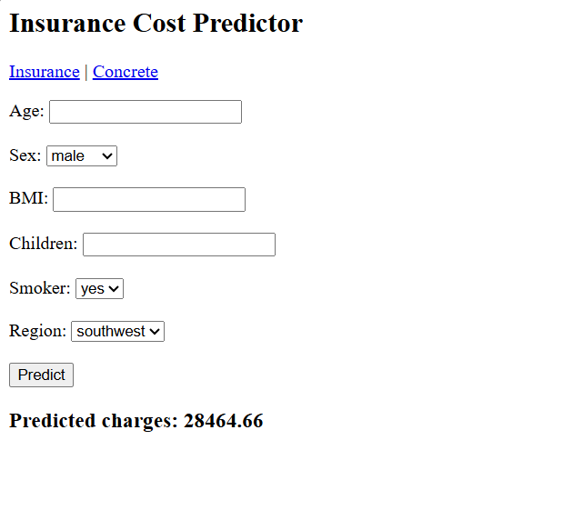
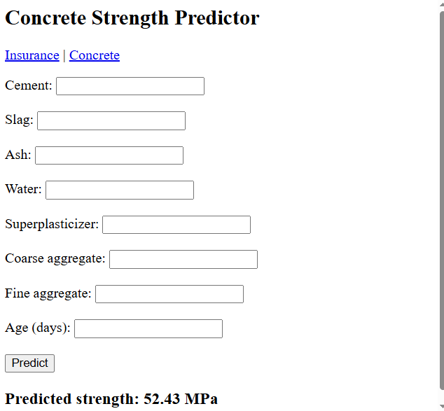

# Linear Regression with Gradio and Flask

Linear Regression on two regression datasets, each with a Gradio and a Flask web interface.

## Datasets
| Dataset | Target | Rows | R2 | MAE | RMSE |
|---|---|---|---|---|---|
| Medical Insurance Cost | charges | 1338 | (fill in) | (fill in) | (fill in) |
| Concrete Compressive Strength | strength (MPa) | 1030 | 0.6276 | 7.7456 | 9.7965 |

Source: https://github.com/stedy/Machine-Learning-with-R-datasets

## Setup
python -m venv venv
venv\Scripts\activate
pip install -r requirements.txt

## Run
python get_data.py
python train.py
python app_gradio.py
python app_flask.py

## Screenshots

